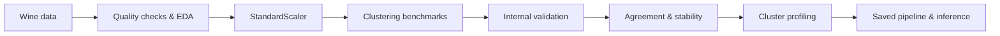
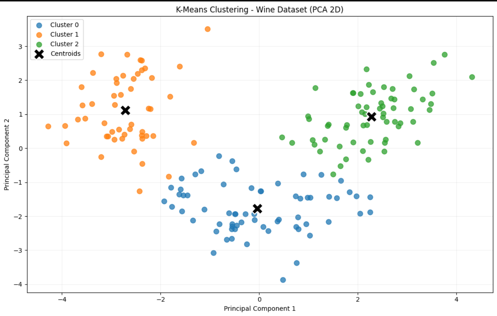
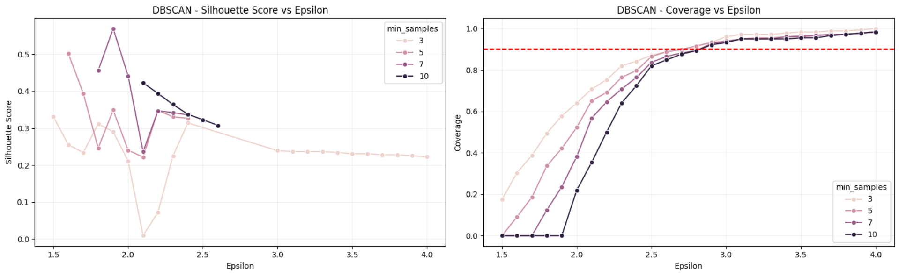
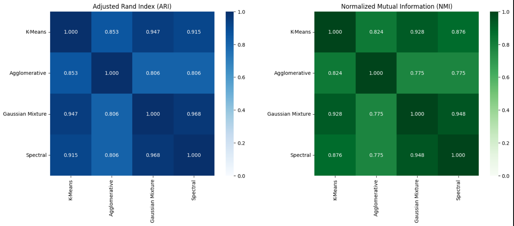
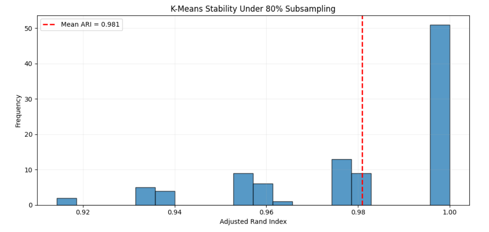
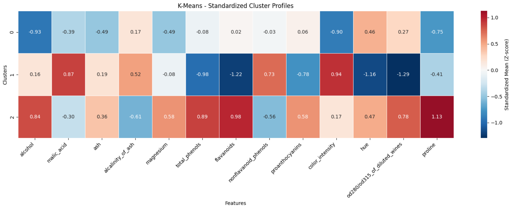
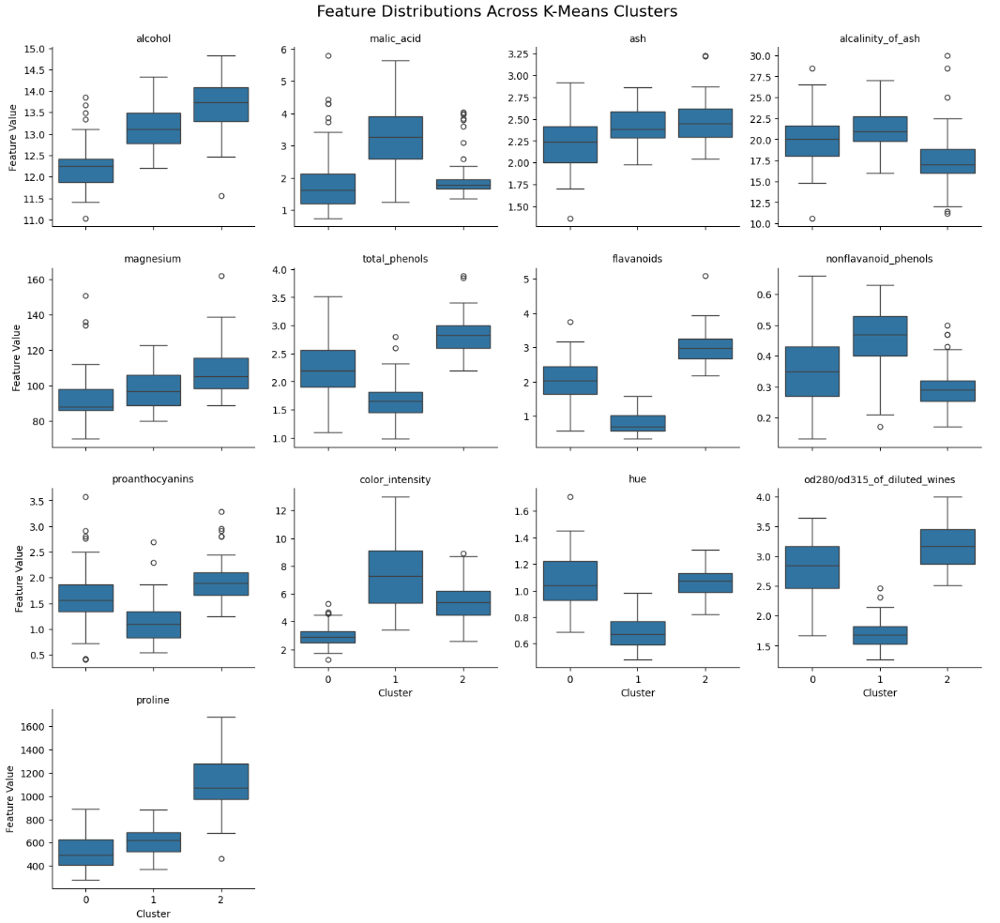
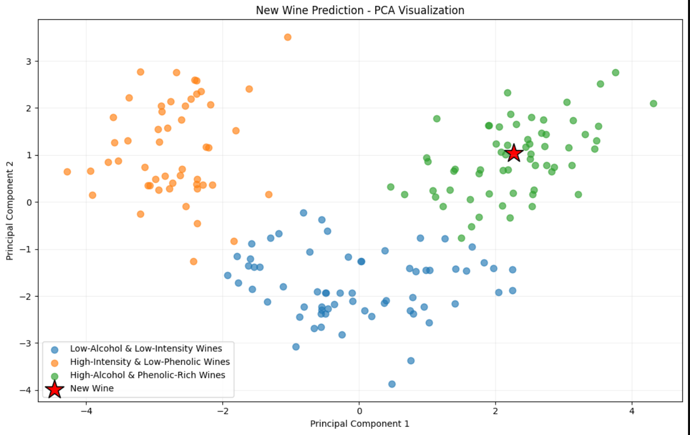

<div align="center">

# 🍷 Wine Intelligence
### Unsupervised Learning · Cluster Discovery · Robustness · Inference

**From 13 chemical measurements to interpretable wine segments.**  
An end-to-end exploration of clustering algorithms, cluster validation, stability, explainability, and reusable inference with scikit-learn.


</div>

---

## ✨ Project at a glance

<table>
<tr>
<td align="center"><b>178</b><br/><sub>Samples</sub></td>
<td align="center"><b>13</b><br/><sub>Chemical features</sub></td>
<td align="center"><b>3</b><br/><sub>K-Means clusters</sub></td>
<td align="center"><b>0.285</b><br/><sub>Silhouette score</sub></td>
<td align="center"><b>0.981</b><br/><sub>Mean subsampling ARI</sub></td>
</tr>
</table>

> **Core question:** Can we discover meaningful wine groups without using the dataset's class labels—and are those groups consistent across algorithms and changes in the data?

The project uses the **Wine dataset bundled with scikit-learn**. Its known classes are **not used to fit the clustering models or to choose the reported model**. The aim is to discover structure based only on the 13 measured chemical features.

## 🧭 The workflow



**What the notebook covers:** missing values and duplicates; IQR-based outlier screening; feature scaling; K-Means, agglomerative clustering, Gaussian mixtures, DBSCAN, spectral clustering, and HDBSCAN; silhouette/DBI/CH evaluation; density-based parameter sweeps; ARI/NMI cross-algorithm agreement; initialization and 80%-subsampling stability; cluster profiling; model persistence; and new-sample prediction.

## 🔬 Cluster discovery

<p align="center">
  
</p>

**K-Means with `k=3`** separates the observations into three reasonably distinct regions in a 2D PCA projection. PCA is **for visualization only**: the model is trained on **all 13 standardized features**. The two displayed components explain **55.41%** of the variance.

| K-Means cluster | Samples | Descriptive segment |
|:--|--:|:--|
| `0` | 65 | **Low-Alcohol & Low-Intensity Wines** |
| `1` | 51 | **High-Intensity & Low-Phenolic Wines** |
| `2` | 62 | **High-Alcohol & Phenolic-Rich Wines** |

*Segment names describe relative chemical profiles, not verified quality grades, tasting notes, or ground-truth wine types.*

## ⚔️ Algorithm benchmark

| Algorithm | Clusters | Coverage | Silhouette ↑ | DBI ↓ | CH ↑ |
|:--|--:|--:|--:|--:|--:|
| **K-Means** | 3 | **100%** | **0.285** | **1.389** | **70.940** |
| Agglomerative | 3 | 100% | 0.277 | 1.419 | 67.647 |
| Gaussian Mixture | 3 | 100% | 0.284 | 1.394 | 70.688 |
| Spectral | 3 | 100% | 0.283 | 1.391 | 70.041 |
| DBSCAN — initial settings | 2 | 69.1% | 0.348 | 1.124 | 68.391 |

> **Important:** DBSCAN's silhouette, DBI, and CH above are computed **only on non-noise observations**. Its metrics therefore cover a different subset from those of the fully assigning methods; a higher silhouette is not automatically a fair win.

### Density-based experiments

**DBSCAN:** Sweeping `eps` and `min_samples` revealed a trade-off between cluster separation and coverage. At `eps=3.0`, `min_samples=3`, DBSCAN found two clusters, assigned **96.1%** of samples, and achieved **0.239** silhouette on assigned observations.

<p align="center"></p>

**HDBSCAN:** Depending on density parameters, the model identified two clusters and left a substantial number of observations as noise:

| `min_cluster_size` | `min_samples` | Cluster sizes | Noise | Coverage | Silhouette* |
|--:|--:|:--|--:|--:|--:|
| 5 | 3 | 96 / 43 | 39 | 78.1% | 0.323 |
| 5 | 5 | 86 / 34 | 58 | 67.4% | 0.352 |
| 5 | 10 | 75 / 28 | 75 | 57.9% | 0.363 |
| 3 | 3 | 172 / 3 | 3 | 98.3% | 0.232 |

<sub>*Silhouette computed for assigned (non-noise) points only. More aggressive noise exclusion may make the retained clusters appear better separated.</sub>

## 🤝 Do different algorithms agree?

<p align="center"></p>

- **GMM ↔ Spectral:** ARI **0.968**, NMI **0.948**
- **K-Means ↔ GMM:** ARI **0.947**, NMI **0.928**
- **K-Means ↔ Agglomerative:** ARI **0.853**, NMI **0.824**

These high scores show **strong agreement between partitions**, not proof that the underlying true classes have been recovered. The four models compared here were all configured to produce three clusters.

## 🛡️ Is the K-Means solution stable?

| Stability experiment | Mean ARI | Std ARI | Min ARI | Max ARI |
|:--|--:|--:|--:|--:|
| 30 random seeds (435 run pairs) | **1.0000** | 0.0000 | 1.0000 | 1.0000 |
| 100 repeats of 80% subsampling | **0.9809** | 0.0234 | 0.9143 | 1.0000 |

<p align="center"></p>

For subsampling, preprocessing was refitted on each subset; the newly learned clusters were compared against the **full-data reference assignments on the same selected observations**. The **5th percentile ARI was 0.935**. This indicates high agreement with the reference under this perturbation scheme, but does not guarantee robustness to distribution shift or prove cluster validity.

## 🧪 Understand the clusters

<p align="center"></p>

| Segment | Relative chemical signature |
|:--|:--|
| **Cluster 0** | Lower alcohol, color intensity, and proline |
| **Cluster 1** | Higher malic acid and color intensity; lower flavanoids and total phenols |
| **Cluster 2** | Higher alcohol, proline, flavanoids, and total phenols |

<details>
<summary><b>🔎 Explore the feature distribution boxplots</b></summary>
<br/>

</details>

## 🚀 Saved-model inference

The trained K-Means model, fitted `StandardScaler`, ordered feature names, and cluster names can be serialized together with `joblib`. New measurements are transformed with the **same fitted scaler**, then assigned to the nearest centroid in standardized feature space.

```python
import joblib
import pandas as pd

artifact = joblib.load("wine_clustering_pipeline.joblib")  # trusted local artifact only

new_wine = pd.DataFrame([{
    "alcohol": 13.8,
    "malic_acid": 1.9,
    "ash": 2.5,
    "alcalinity_of_ash": 16.5,
    "magnesium": 105.0,
    "total_phenols": 2.85,
    "flavanoids": 3.0,
    "nonflavanoid_phenols": 0.30,
    "proanthocyanins": 1.90,
    "color_intensity": 5.6,
    "hue": 1.05,
    "od280/od315_of_diluted_wines": 3.1,
    "proline": 1100.0,
}])

new_wine = new_wine[artifact["feature_names"]]
cluster_id = int(artifact["pipeline"].predict(new_wine)[0])
print(cluster_id, artifact["cluster_names"][cluster_id])
```

**Observed example:** Cluster `2` — **High-Alcohol & Phenolic-Rich Wines**. The sample's standardized-space distances to centroids 2, 0, and 1 were **0.442**, **3.715**, and **5.036**, respectively. These distances are **not probabilities**.

<p align="center"></p>

### Real-time integration idea

```text
Sensor / laboratory analyzer
        ↓
Data acquisition (Serial / MQTT / HTTP)
        ↓
Schema + units + range validation
        ↓
Saved StandardScaler → K-Means
        ↓
Cluster ID + descriptive label + centroid distance
        ↓
Dashboard / logging / monitoring
```

This is a **proposed integration architecture**, **not a deployed sensor system**. The full 13-feature input must be measured or derived reliably; many chemical attributes require specialized instruments. Production use would also require calibration, drift monitoring, input validation, security, and model lifecycle controls.

## ▶️ Run the notebook

1. Clone or download this repository.
2. Install the required libraries (recommended: a virtual environment):

   ```bash
   pip install numpy pandas matplotlib seaborn scikit-learn joblib jupyter plotly
   ```

3. Open the project's `.ipynb` file in Jupyter or Google Colab and run cells in order. The Wine dataset is available through `sklearn.datasets.load_wine`, so no separate CSV is required.
4. To run the saved-model inference example, execute the notebook's serialization cell first so `wine_clustering_pipeline.joblib` exists locally.

> **Compatibility:** `sklearn.cluster.HDBSCAN` requires scikit-learn **1.3+**. For reproducible results, pin and record the library versions used to generate the notebook outputs. Never load untrusted `joblib` files.

## ⚠️ Interpretation & limitations

- K-Means clusters are **moderately separated** in the full standardized feature space (silhouette **0.285**), even though the 2D PCA plot looks visually distinct.
- PCA's first two components preserve **55.41%** of total feature variance; a 2D visualization cannot establish separation in all 13 dimensions.
- ARI/NMI comparisons demonstrate **algorithm agreement**, not agreement with ground truth.
- Stability under different seeds and 80%-subsampling does **not** establish generalization to unseen populations or sensor drift.
- Cluster labels are **descriptive analyst-defined names** and can change if the model is retrained.
- Inference assigns **every valid input** to a K-Means cluster, even if the sample is far from all training clusters. Out-of-distribution checks are advisable in production.

---

<div align="center">

**Built to explore what unsupervised learning can discover—and how to test whether the discovery holds up.**

`Python` · `scikit-learn` · `PCA` · `K-Means` · `GMM` · `DBSCAN` · `HDBSCAN` · `Stability Analysis` · `Model Inference`

</div>
